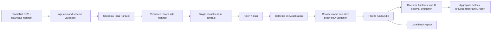

# Architecture review and team-adoptable design

**Review date:** 2026-11-07

**Scope:** Repository code and documentation at commit
`90375675deb984c06b3593016baee38be725bcfe`.

This is a research-pipeline design for the current PhysioNet Challenge 2019
project. It is not a clinical system design, deployment authorization, or claim
of model validity.

## Executive review

The repository is a useful, runnable research scaffold: it downloads and
validates patient records, preserves A/B provenance, constructs causal
features, trains several classical baselines, calibrates on a separate cohort,
selects a notification threshold on validation data, and reports held-out
metrics. The pipeline has meaningful invariant tests and a synthetic smoke
test.

The architecture is not yet ready for a full-cohort or clinical-performance
claim. The real-data profile currently describes a seeded 500-record-per-source
sample; no reproducible full-data model run or uncertainty analysis is recorded.
Prioritize data/evaluation controls and a single feature contract before adding
advanced models, tracking services, APIs, containers, or cloud infrastructure.

## Findings and recommendations

### High priority: clarify external-test status

The project reserves source B for external evaluation, but the local profile
also reports aggregate B outcomes and measurement missingness. That does not
show that B was used to select a model, but it means B has been inspected and
should not be described as a completely untouched test set. Freeze the model,
features, calibration, and alert policy before any further B evaluation. If a
strict confirmatory result is required, use a separately governed holdout or
external dataset that has not been explored.

The local 500-per-source sample is useful for pipeline checks; it is not a
representative performance study. Its 37 septic A records make per-group
calibration, fairness, and uncertainty estimates especially unstable.

### High priority: establish real-data evidence before expanding scope

The README correctly says real-data model quality has not been established.
The current tests establish software invariants on synthetic records; they do
not validate model discrimination, calibration, alert burden, or transport to
another cohort. Keep that distinction in the deck, issues, and reports.

### Medium priority: establish one feature contract

Feature creation exists in `src/sepsis_warning/features.py`, but related logic
is also implemented in `src/sepsis_warning/missingness.py` and
`scripts/causal_features.py`. Their purposes differ, but overlapping
forward-fill, age-since-observation, rolling-statistic, and utility logic can
drift. Make the package feature builder the canonical implementation; make
experiments call it with explicit strategies rather than copy feature
transformations. Keep one tested utility implementation.

### Medium priority: plan for full-cohort scale

The preparation step writes Parquet in batches, but `feature_table` materializes
all patient-hour feature frames in memory. Threshold selection then evaluates
many candidates by repeatedly grouping and summarizing validation rows. This
is reasonable for a subset, but may be slow or memory-intensive at the full
cohort size. Profile the full pipeline before adding more estimators; stream
patient batches and avoid repeated work in the threshold loop where practical.

### Medium priority: strengthen statistical evaluation

Current results report useful row- and patient-level metrics, but do not
provide patient-bootstrap confidence intervals, reliability plots, or subgroup
performance. Hourly rows within a stay are correlated, and a single
patient-level split gives limited evidence of stability. Add patient-grouped
uncertainty and calibration reporting before comparing small performance
differences. Keep thresholds and all choices validation-only.

### Medium priority: harden data and artifact lineage

`read_patient` and `prepare_parquet` implement useful custom checks; Pandera is
not currently part of the project. Preserve the existing checks if adopting a
schema library, and test the failure cases explicitly. The Parquet writer
protects existing outputs in the normal single-process path; its temporary
filename and final rename are not a concurrency lock, so concurrent runs to
the same destination should be rejected or use unique temporary files and
no-clobber publication.

The model bundle stores the estimator, feature columns, window, threshold, and
cooldown. Add a schema/feature-contract version and references to the data and
split manifests so a saved model can be traced to its exact inputs and
configuration.

### Keep deployment out of the critical path

The CLI and offline replay are adequate for this research phase. FastAPI,
Docker, MLflow, DVC remotes, and AWS work add operational and privacy scope
without addressing the current evidence gaps. Approve these only after the
evaluation pipeline is stable and the team has defined a concrete serving or
reproducibility need.

## Proposed architecture



### 1. Ingestion and canonical data

- Keep the downloader as an explicit command; never download implicitly during
  model training.
- Preserve raw PSV files unchanged under the ignored `data/` directory. Record
  source URL/version, download seed/limit, filenames, and SHA-256 hashes in the
  manifest.
- Validate the required schema, numeric observed values, allowed missingness,
  binary/nondecreasing labels, and consecutive ICU-hour indices before
  publication. Do not clip unusual values automatically.
- Write a canonical Parquet dataset containing source, record key, original
  measurements, time, and target. Use `(source, record key)` as the grouping
  identity; do not use either field as a predictor.
- Publish output only after validation and row-count checks pass. Prevent
  concurrent writers to the same output path.

### 2. Split registry and data access boundaries

Create one reproducible split manifest with a seed and source-data hashes:

| Cohort | Purpose | May affect |
|---|---|---|
| A train | Fit features that learn parameters and estimator | Preprocessing/model fit |
| A calibration | Fit the probability mapping with estimator frozen | Calibration only |
| A validation | Compare candidates and select threshold/policy | Model and policy selection |
| A internal test | Final source-A estimate after choices are frozen | Final reporting only |
| B external | Cross-source estimate after choices are frozen | Final reporting only |

Split at record level and assert no key overlap. Report that this does not prove
person-level separation. Keep B outcomes unavailable to training and selection
code. Because aggregate B statistics have already been inspected for the local
sample, describe that sample accurately and reserve a new holdout if an
untouched confirmatory estimate is required.

### 3. Canonical feature contract

Expose one deterministic transformation for a single record:

```text
validated record history -> float32 feature matrix [hour, feature]
```

- Sort and validate hours before transformation; never combine rows from
  different records.
- Feature row `t` may use observations at or before `t` only.
- Keep missingness indicators, never-seen indicators, and measurement-age
  features explicit. Never backfill.
- Separate deterministic causal transforms from fitted preprocessing.
  Imputation/scaling parameters are fitted on train only and serialized with
  the estimator.
- Return stable ordered feature names and a contract version. Exclude target,
  record/source IDs, and administrative unit codes.
- Test that appending or corrupting future hours, labels, or excluded metadata
  leaves all earlier features and fixed-model scores unchanged.

The training, missingness experiments, replay, and any later service should call
this same contract. Strategy comparisons may configure imputation and feature
options but must not reimplement the transformation.

### 4. Training, calibration, and policy selection

Keep the current train/calibration/validation boundaries:

1. Fit each baseline and all learned preprocessing on A train.
2. Freeze the fitted estimator; fit calibration on A calibration.
3. Compare candidates on A validation using a prespecified metric set.
4. Choose the threshold and cooldown policy on A validation only.
5. Freeze the full run configuration before evaluation on A internal test or B.

Start with the existing constant-prior, logistic-regression, random-forest, and
histogram-gradient-boosting baselines. Do not add LightGBM, HMM, GMM, GRU, or
SHAP until the baseline results, compute budget, and acceptance criteria justify
them.

### 5. Evaluation and reporting

Report both hourly and record-level denominators. At minimum include average
precision, AUROC, Brier score/calibration, normalized hourly utility, alert
events, false-alert burden per observed nonseptic patient-day, early-detection
recall, and inferred lead time with left-censoring counts. Keep hourly positive
decisions distinct from cooldown-suppressed notifications.

Add patient-bootstrap intervals (resample records, not hours), calibration
plots, and prespecified age/gender subgroup summaries when sample sizes permit.
Label unavailable or unstable estimates rather than implying precision. Report
source-specific performance and do not retune on B.

### 6. Artifacts and replay

Each immutable run directory should contain:

```text
run/
  config.json                 # versions, seed, feature/policy config
  data_manifest.json          # source version and input hashes
  split_manifest.csv          # record key, source, split
  model.joblib                # estimator, calibrator, preprocessing
  metrics.json                # validation and frozen held-out results
  validation_models.csv
  report.html
```

Include a feature-contract version and hashes of the data/split manifests in
`config.json` or the model bundle. Keep patient-level predictions, split keys,
and replay HTML local and ignored by Git. Test save/load scoring parity on
synthetic fixtures before relying on replay.

## Adoption plan

| Phase | Team focus | Exit criteria |
|---|---|---|
| 0. Freeze scope | Edwin + Mashie | Document that the current sample is exploratory and B has been profiled; agree the holdout policy and minimum real-data report. |
| 1. Data contract | Edwin | Reproducible manifest, explicit validation failure tests, safe output publication, and verified sample/full-cohort counts as feasible. |
| 2. Feature contract | Jawad | One shared implementation; causal, missingness, reset, dtype/order, and fixed-model prefix tests pass. |
| 3. Baseline evidence | Kaiyuan + Edwin | Run the declared data version; train/calibrate/select only on assigned A splits; record model, threshold, calibration, utility, and resource details. |
| 4. Statistical review | Mashie + Kaiyuan | Add patient-grouped uncertainty, calibration, subgroup counts, and limitations; no B-guided choices. |
| 5. Optional methods | Josh + team | Approve compute/dependency scope; add temporal or LightGBM experiments only against the frozen baseline contract. |
| 6. Serving design | leo + team | Proceed only after a stable artifact contract and a defined local service requirement; cloud deployment remains out of scope without approval. |

## Team operating decisions

- Keep the first adopted architecture local and command-line driven.
- Treat the target as the supplied challenge label, already shifted six hours
  early; do not describe it as a clinically validated six-hour risk.
- Do not mark an issue complete because code exists. The owner should run its
  acceptance checks, attach reproducible evidence, and obtain review.
- Never commit raw records, patient-level outputs, credentials, or registry
  artifacts. Follow the PhysioNet license and attribution requirements.
- Use synthetic data for smoke tests only; label synthetic evidence separately
  from real-cohort results.
